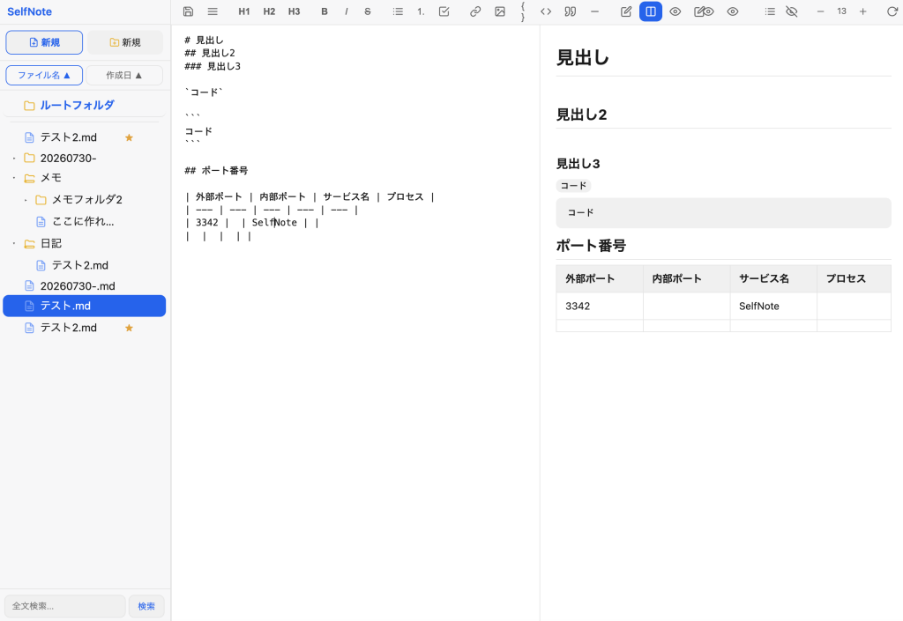

# selfnote

セルフホストで使う Markdown エディタです。ノートはファイル・フォルダとして保存されるので、管理やバックアップが簡単です。

- ブラウザから編集する、Node.js 製の小型アプリです（Listen は `127.0.0.1:3342`）
- コンテナ内での稼働を想定しています（Ubuntu 26.04 イメージのコンテナで動作確認済み）
- Tailscale 環境を想定し、`tailscale serve` 経由で `https://<MagicDNS名>:3342` に公開します
- 別 PC との片方向同期（予備機バックアップ）に対応しています



## 特徴

- Markdown のソース編集・プレビュー・インライン（WYSIWYG 風）編集に対応
- ファイル／フォルダの作成・名前変更・削除・ドラッグ＆ドロップ移動
- 全文検索、お気に入り、編集履歴、隠しファイル表示など
- ライト／ダークテーマ、フォントサイズ、見出し一覧（TOC）
- Tailnet 内の別 PC と 1 日 1 回・片方向で自動同期
- Web UI からワンクリックでアップデート（完了後、自動再起動・リロード）

## 動作環境・前提

| 項目 | 内容 |
| --- | --- |
| OS | Linux コンテナ（Ubuntu 26.04 で動作確認） |
| Node.js | 20 系（インストールスクリプトが自動導入） |
| ポート | 3342（`127.0.0.1` で Listen） |
| 公開方法 | `tailscale serve --https=3342` |
| インストール先 | `/opt/selfnote` |
| ノートの保存先 | `/opt/lxd-data/note` |
| 同期設定 | `/opt/selfnote/sync_config.json`（Tailnet ホスト名を含むため Git 管理外） |

## インストール方法

コンテナ内で下記を実行します。

```bash
curl -fsSL https://raw.githubusercontent.com/hirogura/selfnote/main/install-selfnote.sh | bash
```

インストールスクリプトは以下を自動で行います。

- Node.js が無い場合の導入（nodesource リポジトリ経由）
- `/opt/selfnote` へのファイル配置とデータディレクトリ `/opt/lxd-data/note` の作成
- systemd サービス `selfnote.service` の登録・起動
- `tailscale serve` の設定（`https://<MagicDNS名>:3342`）
- データディレクトリの権限修復（後述）

完了後、表示された URL（`https://<MagicDNS名>:3342`）にアクセスしてください。

### データディレクトリについて

ノートの実体は `/opt/lxd-data/note` に保存されます。LXD の共有マウント等で、このディレクトリの所有者 UID/GID がコンテナの user namespace にマップされていない場合（root でも書き込めない状態）、インストール時に権限の付け直し、もしくはディレクトリの作り直しと中身のコピーによって自動修復を試みます（v1.5.2）。修復できない場合は、LXD ホスト側で所有者を修復してから再実行してください。

## 主な機能

### ファイル管理

- ルートフォルダ／サブフォルダにファイル・フォルダを作成
- 名前変更、削除、フォルダへのドラッグ＆ドロップ移動
- 右クリックメニューからも作成・名前変更・削除が可能
- ファイル名に `.md` が無い場合は自動付与。同名ファイルは `(2)`、`(3)` … と自動採番
- 隠しファイル（`.` で始まるファイル）の表示切替

### Markdown 編集

ツールバーから以下の書式を挿入できます。

- 見出し（H1〜H3）
- 太字・斜体・打ち消し線
- 箇条書き・番号付きリスト・チェックリスト
- リンク・画像・インラインコード・コードブロック・引用・水平線・表（v1.5.0）

キーボードショートカット:

| 操作 | ショートカット |
| --- | --- |
| 保存 | `Ctrl+S`（Mac は `Cmd+S`） |
| 太字 | `Ctrl+B`（Mac は `Cmd+B`） |
| 斜体 | `Ctrl+I`（Mac は `Cmd+I`） |
| インデント（ソース） | `Tab`（半角スペース 2 個） |

編集内容は入力から約 1 秒後に自動保存されます。コードブロックには「copy」ボタンが付きます。

### 表示モード

ツールバーで以下の 5 種類を切り替えられます（選択はブラウザに保存されます）。

- ソース編集
- 分割（ソース＋プレビュー、スクロール連動）
- プレビュー
- インライン＋ソース（WYSIWYG 風編集とソースの併記）
- インラインのみ

### 検索・整理

- 全文検索（`.md` ファイルの内容を検索し、該当行とファイルを表示）
- お気に入り（★）でよく使うファイルを一覧の先頭にピン留め
- 編集履歴（最近更新したファイルを最大 100 件表示）
- 並び替え（ファイル名／作成日の昇順・降順）

### 見た目

- ライト／ダークテーマ切替
- エディタ・プレビューのフォントサイズ調整（10〜24 px）
- 見出し一覧（H1〜H3）からのジャンプ
- サイドバーの幅変更・表示切替

### 別 PC との同期（v1.4.0 以降）

Tailnet 内の別 PC の selfnote と、1 日 1 回・片方向でノート全体を同期します（予備機用途・同期先は 1 箇所のみ）。設定は同期アイコン（🔄）から行います。

- **役割**: 「同期元（送る側）」か「同期先（受ける側）」を選択します。保存すると相手側の役割も自動で反対に切り替わります（v1.4.3）
- **同期相手**: `tailscale status` から取得したピア一覧（稼働中が先頭）から選択します
- **同期時刻**: `HH:MM` 形式（既定値 `03:00`）。この時刻以降に 1 日 1 回自動同期します。時刻を変更すると当日の同期済みフラグがリセットされ、すぐにテストできます（v1.4.4）
- **今すぐ同期**: 設定を保存した後、手動で即時同期を実行できます
- **同期を停止**: 相手指定を解除し、相手側にも停止を通知します（v1.4.1）
- 同期の時刻・結果（成功／失敗）は日本時間の読みやすい形式で表示されます（v1.5.1）

同期対象は `/opt/lxd-data/note` 配下の全ファイルで、1 ファイル 20 MB までが送信対象です（それより大きいファイルは現地に保持されます）。通信は Tailnet 内を前提としています。

> **Note**: 同期を使う両方の PC を最新版の selfnote に更新してください。旧バージョンでは相手側への自動設定の反映に失敗する場合があります。

### アップデート・再起動

- サイドバーの「アップデート」ボタンで最新版をダウンロードして適用します。完了後、自動でサービスを再起動し、ページをリロードします（v1.4.5）
- 「再起動」ボタンで `selfnote.service` を再起動できます

## サービス操作

```bash
systemctl start selfnote     # 起動
systemctl stop selfnote      # 停止
systemctl restart selfnote   # 再起動
journalctl -u selfnote -f    # ログ確認
```

## アンインストール方法

```bash
# 1. サービスを停止・無効化
sudo systemctl stop selfnote
sudo systemctl disable selfnote

# 2. tailscale serve の設定を解除(ポート3342)
sudo tailscale serve --https=3342 off

# 3. systemdユニットファイルを削除
sudo rm /etc/systemd/system/selfnote.service
sudo systemctl daemon-reload
sudo systemctl reset-failed

# 4. インストールディレクトリを削除(同期設定 sync_config.json もここに含まれます)
sudo rm -rf /opt/selfnote
```

### データを残すか削除するか

ノートの実体データは `/opt/lxd-data/note` に保存されています。これは他のサービス（`/opt/lxd-data/` を共有）と混在している可能性があるので、このディレクトリはインストールディレクトリとは別に判断してください。

- メモを残しておきたい場合 → 何もしない（そのまま `/opt/lxd-data/note` に残ります）
- 完全に削除したい場合:

```bash
sudo rm -rf /opt/lxd-data/note
```

## ライセンス

このプロジェクトは [MIT License](LICENSE) の下で公開されています。
